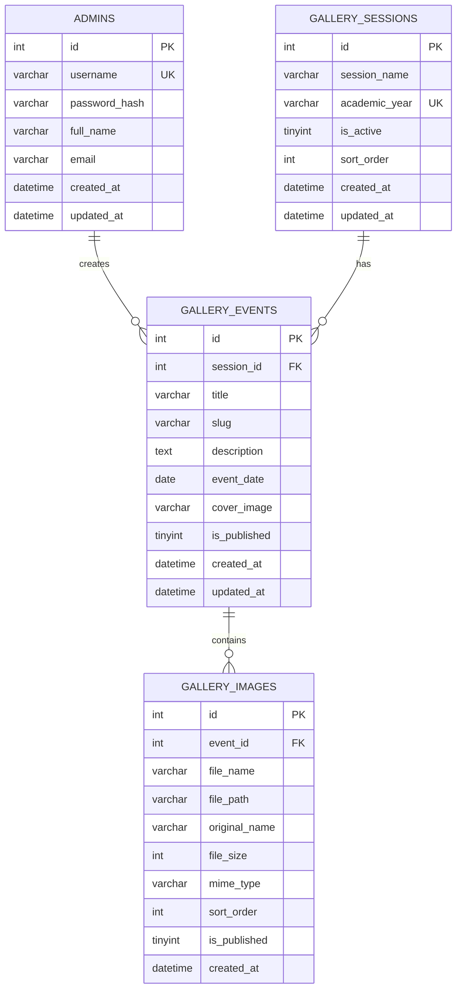
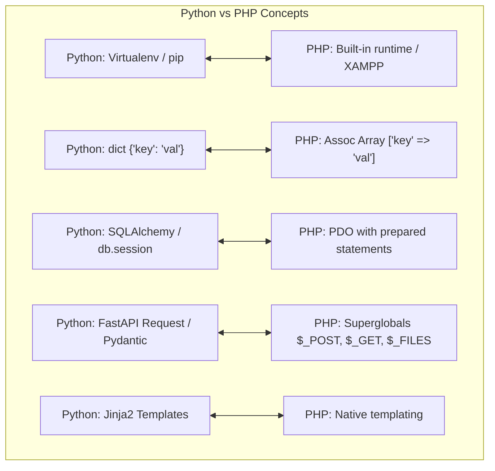

# SCMIPS Gallery Admin Panel — Learning & Implementation Plan

---

## 1. Project Overview

We are building a secure, lightweight, and maintainable **Gallery Admin Panel** for the existing **SCMIPS** (Shri Cloth Market Institute of Professional Studies, Indore) website.

The primary objective is to empower authorized college staff and administrators to manage academic sessions, events, and gallery photographs dynamically through an intuitive web interface, eliminating the need to manually edit static HTML/PHP files or upload images via raw FTP.

The admin panel will be accessible directly on the college domain at:
```text
https://scmips.in/admin/
```

### Primary Goals
1. **Dynamic Gallery Management:** Full administrative control to create, update, and organize academic sessions, events, and gallery images.
2. **Preserve Existing Public Site:** Strictly maintain the public website's design, styling, layout, existing pages, navigation, and legacy gallery images without visual disruption.
3. **Seamless Integration:** Replace hardcoded gallery sections with dynamic PHP/MySQL data retrieval while keeping all other 450+ files untouched.
4. **Beginner-Friendly Architecture:** Build a modular, framework-free PHP 8 application using PDO and MySQL that is easy to understand, inspect, debug, and maintain.
5. **Learn-by-Building:** Serve as a practical bridge for a developer transitioning from Python fundamentals to real-world PHP and MySQL backend development.

### Scope Boundary
- **In Scope:** Administrative authentication, session management, event management, multi-image upload and deletion, database schema design, admin dashboard, and integration with the public gallery pages (`gallery.html`, `gallery*.html`, `showimages.php`).
- **Out of Scope (for MVP):** Full CMS for other website pages (Admissions, Courses, Faculty, Notices), student portals, payment gateways, or rewriting the entire site into a modern framework.

---

## 2. Final Technology Stack

The previous architecture using Python (FastAPI, Uvicorn, PostgreSQL, SQLAlchemy, Alembic) has been completely retired in favor of native PHP and MySQL to match the existing hosting environment and eliminate external hosting dependencies.

| Layer | Selected Technology | Purpose & Justification |
| :--- | :--- | :--- |
| **Backend Language** | **PHP 8.x** | Native runtime on existing cPanel hosting; eliminates need for external VPS or container orchestration. |
| **Database** | **MySQL** | Standard relational database available on cPanel hosting. |
| **DB Connectivity** | **PDO (PHP Data Objects)** | Secure database abstraction supporting prepared statements to eliminate SQL injection vulnerabilities. |
| **Frontend Layout** | **HTML5, CSS3, JavaScript** | Clean, standards-compliant interface for forms and dashboards. |
| **UI Framework** | **Bootstrap 5** | Responsive, mobile-ready admin UI components (tables, modals, alerts, cards) without complex build tools. |
| **Image Processing** | **PHP GD Library** *(if hosting enabled)* | Server-side image dimension verification, thumbnail generation, and MIME validation. |
| **Local Dev Server** | **PHP Built-in Server / XAMPP** | Lightweight zero-config development environment on Windows. |
| **Version Control** | **Git & GitHub** | Source code tracking, milestone commits, and backup. |
| **Production Hosting** | **Existing Windows Hosting with cPanel** | Shared hosting at `scmips.in` accessible via cPanel File Manager and FTP/SFTP. |

> [!IMPORTANT]
> **No External Frameworks:** Do not introduce Laravel, Symfony, CodeIgniter, or complex composer dependencies. We are building a lightweight, vanilla PHP application where every line of code is transparent and educational.

---

## 3. Existing Website Context & Constraints

The existing SCMIPS production environment imposes specific operational boundaries that must guide every architectural choice:

1. **Shared Hosting Reality:** The website runs on a Windows-based cPanel hosting server. Separate hosting or containerized microservices are not possible.
2. **Path Constraints:** The admin panel must reside in `/admin/` relative to the public root (`scmips.in/admin/`).
3. **Incomplete Source Archive:** The provided source archive contains ~458 files (64 HTML, 11 PHP, 15 JS, 9 CSS, plus image assets). It represents the latest snapshot available, but **must never be assumed to be 100% complete or identical to production**.
4. **No Existing Database:** There is currently no live MySQL database powering the website; existing pages are static or use flat-file PHP scripts (`showimages.php`). A new MySQL database must be created via cPanel.
5. **Isolation Principle:** Only gallery-related files may be modified. All other website sections (admissions, academics, contacts, navigation headers, footers) must remain 100% intact.
6. **Asset Preservation:** Existing gallery assets organized by academic year (e.g., `assets/images/gallery/201819/`, `201920/`, `202122/`) must never be deleted, moved, or overwritten.
7. **Pre-Deployment Backup Mandatory:** A full cPanel/FTP backup must be downloaded and archived prior to modifying any file on production.

---

## 4. Source Code Inspection & Technical Verification Audit

A comprehensive, read-only inspection of the complete website snapshot (`reference/scmips-website-source/`) was performed to map the legacy codebase, gallery mechanics, asset dependencies, and database footprints.

---

### 4.1 Verified Findings

#### A. Repository & File System Overview
* **Total Archive Files:** ~458 files grouped into:
  * **Images:** 247 `.jpg`, 41 `.jpeg`, 24 `.png`, 6 `.svg`
  * **Web Pages:** 64 `.html`, 11 `.php`, 1 `.shtml`
  * **Stylesheets & Scripts:** 9 `.css` (Bootstrap 4.0.0-beta.2, Swiper, custom), 15 `.js` (jQuery 3.2.1, Bootstrap 4 bundle, simpleLightbox in `main.js`, Sheetrock.js, GLightbox)
  * **Documents & Data:** 5 `.json` (faculty data), 4 `.pdf`, 2 `.docx`, 1 `.xlsx`, 1 `.txt`
  * **Fonts & Maps:** 4 web font files, 3 source maps, 1 `.ftpquota`
* **File Separation:** The reference website code resides in `reference/scmips-website-source/` (gitignored), ensuring zero accidental alteration of legacy assets.

#### B. Database Status & Legacy PHP Scripts
* **Active Database Connection:** **NONE.** There is zero active SQL or database code anywhere in the website.
* **Legacy DB Reference:** An old reference `//include_once 'conMySql.php';` was found commented out inside `linkmail.php` and `sendadmenq.php`. The file `conMySql.php` does not exist in the archive.
* **Audit of all 11 PHP Files:**
  1. `admission-enquiry.php`: Static HTML form for admission enquiries (POST to `sendadmenq.php`).
  2. `fac-opening.php`: Static HTML form for job vacancies (POST to `linkmail.php`).
  3. `linkmail.php`: Processes faculty job applications using PHP native `mail()`.
  4. `linkmails.php`: Secondary contact form processor via PHP `mail()`.
  5. `mail.php`: Contact / enquiry email dispatcher via PHP `mail()`.
  6. `sendadmenq.php`: Admission enquiry processor via PHP `mail()`.
  7. `showimages.php` (in root): Incomplete prototype reading `/assets/images/gallery/201819/*.jpg` with hardcoded absolute path.
  8. `showimg.php` (in root): Standalone 10-line test script using `scandir('assets/images/gallery/201819/')`.
  9. `assets/images/showimg.php`: Test script reading `/assets/images/*.{jpg,png...}`.
  10. `assets/images/gallery/201819/showimages.php`: Duplicate of root `showimages.php`.
  11. `assets/images/gallery/201819/showimg.php`: Duplicate test script inside the image folder.

#### C. Gallery Hierarchy & Public Page Structure
The gallery follows a clear 3-tier logical structure:
$$\text{Academic Session (e.g. 2018–2019)} \longrightarrow \text{Events (e.g. Blood Donation Camp)} \longrightarrow \text{Images}$$

* **`gallery.html` (Gallery Portal):**
  * Displays academic session cards inside `<div class="home-page-icon-boxes">`.
  * Active links: `gallery202122.html`, `gallery201920.html`, `gallery201819.html`.
  * Broken / placeholder links: `SESSION 2017-2018` and `SESSION 2016-2017` link to `./matrimonial/` (directory does not exist).
* **`gallery201819.html`:**
  * 6 distinct event sections under Session 2018–2019:
    1. *Blood Donation Camp* (images 1–6)
    2. *Career Guidance* (images 7–12)
    3. *Fresher's Party* (images 13–18)
    4. *Induction* (images 19–24)
    5. *Koshal Bharat* (images 25–30)
    6. *Seminar* (images 31–45; HTML requests up to 48)
* **`gallery201920.html`:**
  * 11 distinct event sections under Session 2019–2020:
    1. *Annual Function* (images 1–87)
    2. *Career Guidance* (images 88–103)
    3. *Fresher's Party* (images 104–121)
    4. *Induction*, *Manchal Village Visit*, *Om Shanti Om*, *Personality Development*, *Republic Day*, *Women Health Seminar*, *Yoga Activity*, *Youth Festival Quiz*.
* **`gallery202122.html`:**
  * Contains a single flat gallery grid of 10 image blocks (9 unique files).
* **`gallary.html` (Spelling typo page):**
  * Legacy standalone page referencing `assets/images/gallery/1.jpg`–`20.jpg` with a banner image from SVIMI.
* **`photo-gallery.html`:**
  * Inherited template from sister college SVIM; uses `assets/images/events/media/1.jpg`–`20.jpg`.
* **`201011.html` through `201819.html`:**
  * **Not galleries** — these are static tables of student placement statistics.

#### D. Image Assets & Verified Path Discrepancies
| Directory Path | Files on Disk | Referenced in HTML | Discrepancies & Broken Links Uncovered |
| :--- | :---: | :---: | :--- |
| `assets/images/gallery/` | 14 files | 20 images (`gallary.html`) | **`15.jpg` through `20.jpg` are missing on disk** (broken links in legacy `gallary.html`). |
| `assets/images/gallery/201819/` | 45 images | 48 images (`gallery201819.html`) | **`46.jpg`, `47.jpg`, and `48.jpg` do not exist on disk** (broken links in legacy HTML). |
| `assets/images/gallery/201920/` | 79 images | 79 images (`gallery201920.html`) | **Extension mismatch:** HTML calls `114.jpg`, but file on disk is `114.jpeg` (broken on Linux/cPanel). |
| `assets/images/gallery/202122/` | 9 images | 10 images (`gallery202122.html`) | File `9.JPG` is hardcoded twice in HTML. Mixed extension casing (`.JPG` and `.jpg`). |

#### E. Reusable Frontend Styling & JavaScript Libraries
* **Public UI Framework:** Bootstrap v4.0.0-beta.2 (`assets/css/bootstrap.min.css`).
* **SCMIPS Color Palette:**
  * Primary Navy: `#021371`
  * Secondary Amber/Gold: `#f1a238`
  * Dark Slate Text: `#212529`
  * Light Background: `#ecf2f5`
* **Lightbox Plugin:** **simpleLightbox** (bundled inside `assets/js/main.js`). Initialized via:
  ```javascript
  $('#photo-gallery .galleryImg').simpleLightbox({
    sourceAttr: "data-imgsrc"
  });
  ```
* **HTML Image Card Structure:**
  ```html
  <div data-imgsrc="assets/images/gallery/201819/1.jpg" class="galleryImg col-xl-3 col-lg-3 col-md-6 mb-4">
    
  </div>
  ```
* **External Dynamic Dependencies:** Google Sheets integration via `Sheetrock.js` to populate notice-board tickers dynamically.

#### F. Missing Linked Target Files Identified
Inspection of navigation and anchors across legacy HTML revealed several non-existent targets:
1. `about-institute-description.html` (linked from main nav menu; missing)
2. `career.html` (linked from footers; missing)
3. `recongnition-description.html` (linked from nav; missing)
4. `scholarship.html` (missing)
5. `semhall.html` (linked from nav; missing)
6. `placement/students-testimonials.html` (missing)
7. `./matrimonial/` (placeholder link on gallery session cards; missing)
8. `/Websites/scmips/` (hardcoded local root on brand logo in header)

---

### 4.2 Assumptions

1. **Hosting Web Server:** Production environment is Windows cPanel or Apache-compatible Linux shared hosting with PHP 8.x and MySQL 5.7+/8.0.
2. **URL Rewriting & Root Path:** The website is assumed to reside at domain root (`scmips.in/`), while the admin panel resides at `scmips.in/admin/`.
3. **Public Display Parity:** Visitors expect the dynamic gallery to visually look 100% indistinguishable from the current static design, with identical responsiveness, layout, colors, and lightbox behavior.
4. **Admin UI Framework Independence:** The admin panel can use **Bootstrap 5** for modern administration components (modals, toasts, forms, flexbox) without any conflict, since admin pages are completely decoupled from public templates.

---

### 4.3 Missing Information Requiring Confirmation

1. **Production Database Credentials:** Exact live MySQL host, database name, user, and password will be needed prior to production deployment (local development uses `scmips_db` with `root`).
2. **Missing Media Status:** Confirmation whether the missing image files (`46.jpg`–`48.jpg`, `15.jpg`–`20.jpg`) and missing pages (`about-institute-description.html`, `semhall.html`) exist on the live server or were omitted from the download archive.
3. **cPanel / FTP Credentials:** Pre-deployment backup requires valid cPanel or FTP access to create an archive of the live server before modifying files.

---

### 4.4 Files Requiring Modification & Safe Integration Strategy

#### Files Requiring Adaptation:
1. **`gallery.html` $\longrightarrow$ `gallery.php`:**
   * Convert static session cards into a dynamic PDO loop querying active records from `gallery_sessions`.
   * Keep a 301 redirect from `gallery.html` to `gallery.php` (or use `.htaccess` rewrite) to prevent dead external bookmarks.
2. **Session Pages (`gallery201819.html`, `gallery201920.html`, `gallery202122.html`) $\longrightarrow$ `gallery-session.php`:**
   * Introduce a unified dynamic template `gallery-session.php?id=X` (or clean slug `gallery/2021-2022`).
   * Fetches session details, published events, and images dynamically from MySQL.
   * Renders the identical `.galleryImg` HTML markup and activates `simpleLightbox`.
3. **`events.html`:**
   * Update the single link pointing to `gallery.html` (line 246) to point to `gallery.php`.

#### Safe Rollout Principles:
* **Zero Disruption:** 450+ non-gallery files (admissions, courses, faculties, placement, notices) remain completely untouched.
* **Database Pre-Seeding:** Seed `scmips_db` with existing sessions (2018–2019, 2019–2020, 2021–2022) and their corresponding image file paths before switching public links, guaranteeing zero downtime or lost photos.
* **Pre-Deployment Backup:** Complete tar/zip backup of live web root before uploading the dynamic public templates.

---

---

## 5. Suggested Project & Folder Structure

The application will reside in the `admin/` directory alongside the existing website files, keeping core configuration protected:

```text
scmips/                              (Web root / public_html)
│
├── admin/                           (Admin Panel Module)
│   ├── index.php                    (Redirects to dashboard or login)
│   ├── login.php                    (Admin authentication form & handler)
│   ├── logout.php                   (Session destruction & logout)
│   ├── dashboard.php                (Summary metrics & quick actions)
│   │
│   ├── config/
│   │   ├── config.php               (DB credentials & constants - gitignored)
│   │   └── config.sample.php        (Sample configuration template for Git)
│   │
│   ├── includes/
│   │   ├── db.php                   (PDO database connection instance)
│   │   ├── auth.php                 (Session validation & access gatekeeper)
│   │   ├── csrf.php                 (CSRF token generation & verification)
│   │   ├── functions.php            (Sanitization, helpers, file validators)
│   │   ├── header.php               (Reusable Bootstrap admin navigation)
│   │   └── footer.php               (Reusable admin footer & script tags)
│   │
│   ├── sessions/
│   │   ├── index.php                (List all academic sessions)
│   │   ├── create.php               (Add new session form & processor)
│   │   ├── edit.php                 (Update session details)
│   │   └── delete.php               (Safe deletion with dependency check)
│   │
│   ├── events/
│   │   ├── index.php                (List events with session filter)
│   │   ├── create.php               (Add new event with session picker)
│   │   ├── edit.php                 (Edit event title, date, status)
│   │   └── delete.php               (Delete event & cascade images)
│   │
│   ├── images/
│   │   ├── upload.php               (Multi-image upload form & handler)
│   │   └── delete.php               (Delete single image & unlink file)
│   │
│   ├── assets/
│   │   ├── css/
│   │   │   └── admin.css            (Custom admin styling)
│   │   └── js/
│   │       └── admin.js             (Form validation, preview & confirmation)
│   │
│   └── uploads/
│       ├── .htaccess                (Apache: Disable script execution)
│       ├── web.config               (IIS/Windows: Disable script execution)
│       └── gallery/                 (Target directory for admin uploads)
│
├── assets/                          (Existing website static assets)
│   └── images/
│       └── gallery/                 (Existing legacy gallery images preserved)
│
├── gallery.php                      (Dynamic public gallery landing page)
├── gallery-view.php                 (Public event/session image viewer)
└── ...                              (All remaining existing website files)
```

---

## 6. Database Design (MySQL + PDO)

We will create a normalized relational schema with explicit foreign keys, indexes, and referential integrity constraints.



### SQL Table Schema (DDL)

```sql
-- 1. Admins Table
CREATE TABLE IF NOT EXISTS `admins` (
    `id` INT UNSIGNED AUTO_INCREMENT PRIMARY KEY,
    `username` VARCHAR(50) NOT NULL UNIQUE,
    `password_hash` VARCHAR(255) NOT NULL,
    `full_name` VARCHAR(100) NOT NULL,
    `email` VARCHAR(100) NULL,
    `created_at` DATETIME NOT NULL DEFAULT CURRENT_TIMESTAMP,
    `updated_at` DATETIME NOT NULL DEFAULT CURRENT_TIMESTAMP ON UPDATE CURRENT_TIMESTAMP
) ENGINE=InnoDB DEFAULT CHARSET=utf8mb4 COLLATE=utf8mb4_unicode_ci;

-- 2. Gallery Sessions Table
CREATE TABLE IF NOT EXISTS `gallery_sessions` (
    `id` INT UNSIGNED AUTO_INCREMENT PRIMARY KEY,
    `session_name` VARCHAR(100) NOT NULL,            -- e.g. "Session 2021-2022"
    `academic_year` VARCHAR(20) NOT NULL UNIQUE,      -- e.g. "2021-2022"
    `is_active` TINYINT(1) NOT NULL DEFAULT 1,
    `sort_order` INT NOT NULL DEFAULT 0,
    `created_at` DATETIME NOT NULL DEFAULT CURRENT_TIMESTAMP,
    `updated_at` DATETIME NOT NULL DEFAULT CURRENT_TIMESTAMP ON UPDATE CURRENT_TIMESTAMP,
    INDEX `idx_sessions_year` (`academic_year`)
) ENGINE=InnoDB DEFAULT CHARSET=utf8mb4 COLLATE=utf8mb4_unicode_ci;

-- 3. Gallery Events Table
CREATE TABLE IF NOT EXISTS `gallery_events` (
    `id` INT UNSIGNED AUTO_INCREMENT PRIMARY KEY,
    `session_id` INT UNSIGNED NOT NULL,
    `title` VARCHAR(200) NOT NULL,                    -- e.g. "Annual Sports Day 2022"
    `slug` VARCHAR(220) NOT NULL,
    `description` TEXT NULL,
    `event_date` DATE NULL,
    `cover_image` VARCHAR(255) NULL,
    `is_published` TINYINT(1) NOT NULL DEFAULT 1,
    `created_at` DATETIME NOT NULL DEFAULT CURRENT_TIMESTAMP,
    `updated_at` DATETIME NOT NULL DEFAULT CURRENT_TIMESTAMP ON UPDATE CURRENT_TIMESTAMP,
    INDEX `idx_events_session` (`session_id`),
    INDEX `idx_events_published` (`is_published`),
    CONSTRAINT `fk_events_session`
        FOREIGN KEY (`session_id`) REFERENCES `gallery_sessions` (`id`)
        ON DELETE RESTRICT ON UPDATE CASCADE
) ENGINE=InnoDB DEFAULT CHARSET=utf8mb4 COLLATE=utf8mb4_unicode_ci;

-- 4. Gallery Images Table
CREATE TABLE IF NOT EXISTS `gallery_images` (
    `id` INT UNSIGNED AUTO_INCREMENT PRIMARY KEY,
    `event_id` INT UNSIGNED NOT NULL,
    `file_name` VARCHAR(255) NOT NULL,                -- e.g. "img_65fa89b21a8d9_1710928306.jpg"
    `file_path` VARCHAR(255) NOT NULL,                -- e.g. "admin/uploads/gallery/2022/..."
    `original_name` VARCHAR(255) NOT NULL,            -- e.g. "DSC_0045.JPG"
    `file_size` INT UNSIGNED NOT NULL DEFAULT 0,      -- In bytes
    `mime_type` VARCHAR(50) NOT NULL,                 -- e.g. "image/jpeg"
    `sort_order` INT NOT NULL DEFAULT 0,
    `is_published` TINYINT(1) NOT NULL DEFAULT 1,
    `created_at` DATETIME NOT NULL DEFAULT CURRENT_TIMESTAMP,
    INDEX `idx_images_event` (`event_id`),
    INDEX `idx_images_published` (`is_published`),
    CONSTRAINT `fk_images_event`
        FOREIGN KEY (`event_id`) REFERENCES `gallery_events` (`id`)
        ON DELETE CASCADE ON UPDATE CASCADE
) ENGINE=InnoDB DEFAULT CHARSET=utf8mb4 COLLATE=utf8mb4_unicode_ci;
```

---

## 7. Security Architecture & Implementation Rules

Every script in the admin panel and public endpoints must adhere strictly to these defensive standards:

### 1. Database Query Safety (Zero SQL Injection)
- **Rule:** Never concatenate variables into SQL strings.
- **Implementation:** Always use PDO prepared statements with parameter binding:
  ```php
  $stmt = $pdo->prepare("SELECT id, title FROM gallery_events WHERE session_id = :session_id AND is_published = 1");
  $stmt->execute([':session_id' => $sessionId]);
  $events = $stmt->fetchAll(PDO::FETCH_ASSOC);
  ```

### 2. Password Security
- **Hashing:** Use `password_hash($plainPassword, PASSWORD_DEFAULT)` (BCrypt / Argon2id).
- **Verification:** Always verify using `password_verify($inputPassword, $storedHash)`. Never use MD5 or SHA1.

### 3. Session Security
- Configure secure session cookie parameters in a global include:
  ```php
  ini_set('session.cookie_httponly', 1);
  ini_set('session.use_only_cookies', 1);
  if (isset($_SERVER['HTTPS']) && $_SERVER['HTTPS'] === 'on') {
      ini_set('session.cookie_secure', 1);
  }
  session_start();
  ```
- Call `session_regenerate_id(true)` immediately after successful credentials verification to prevent session fixation.
- Terminate sessions cleanly on logout via `$_SESSION = []` and `session_destroy()`.

### 4. CSRF (Cross-Site Request Forgery) Protection
- Generate a cryptographically secure token per session:
  ```php
  if (empty($_SESSION['csrf_token'])) {
      $_SESSION['csrf_token'] = bin2hex(random_bytes(32));
  }
  ```
- Include `<input type="hidden" name="csrf_token" value="<?= htmlspecialchars($_SESSION['csrf_token']) ?>">` on all forms.
- Validate on every `POST` request using `hash_equals($_SESSION['csrf_token'], $_POST['csrf_token'] ?? '')`. Reject invalid requests with HTTP 403.

### 5. Secure File Upload Pipeline
1. **Never Trust Client Extensions:** Do not validate uploads using `$_FILES['image']['name']` alone.
2. **Validate Real MIME Type:** Inspect actual file magic bytes with `finfo`:
   ```php
   $finfo = new finfo(FILEINFO_MIME_TYPE);
   $mime = $finfo->file($_FILES['image']['tmp_name']);
   $allowedMimes = ['image/jpeg' => 'jpg', 'image/png' => 'png', 'image/webp' => 'webp'];
   if (!array_key_exists($mime, $allowedMimes)) {
       throw new Exception("Invalid file type. Only JPG, PNG, and WebP are allowed.");
   }
   ```
3. **Randomize Server Filenames:** Construct unpredictable names:
   ```php
   $extension = $allowedMimes[$mime];
   $uniqueName = 'img_' . bin2hex(random_bytes(10)) . '_' . time() . '.' . $extension;
   ```
4. **Execution Prevention:** Place a `.htaccess` and `web.config` inside `admin/uploads/` denying script execution (`.php`, `.phtml`, `.exe`).
5. **Path Traversal Protection:** Sanitize all file operations using `basename()` before `unlink()`.

### 6. XSS Prevention
- All user-supplied output in HTML must pass through `htmlspecialchars($string, ENT_QUOTES, 'UTF-8')`.

### 7. Production Error Handling
- Local development: `display_errors = 1`, `error_reporting(E_ALL)`.
- Production: `display_errors = 0`, log errors to server log, and show a clean friendly error page to users.

---

## 8. Learn-by-Building Methodology: Python to PHP

As a Python beginner learning PHP and MySQL through this build, keep these foundational mental models in mind:



### The 6-Step Implementation Cycle for Every Phase
1. **Understand:** Read the concept summary and what problem this phase solves.
2. **Inspect:** Check existing files before writing code.
3. **Execute Cursor Prompt:** Run the provided prompt in Cursor to generate targeted, modular files.
4. **Code Walkthrough:** Inspect every generated function to ensure there are no black boxes.
5. **Manual Test:** Follow the step-by-step verification instructions.
6. **Notebook Checkpoint:** Record the key takeaway note in your developer journal.

---

## 9. Step-by-Step Implementation Phases

```mermaid
flowchart LR
    P1[Phase 1: Setup] --> P2[Phase 2: Source Inspection]
    P2 --> P3[Phase 3: Local Dev]
    P3 --> P4[Phase 4: DB & PDO]
    P4 --> P5[Phase 5: Auth & Layout]
    P5 --> P6[Phase 6: Dashboard]
    P6 --> P7[Phase 7: Sessions]
    P7 --> P8[Phase 8: Events]
    P8 --> P9[Phase 9: Images Upload]
    P9 --> P10[Phase 10: Public Gallery]
    P10 --> P11[Phase 11: Security & QA]
    P11 --> P12[Phase 12: Deployment]
```



---

### Phase 1: Environment & Project Setup

#### What We Are Building
A clean, version-controlled project workspace that separates administrative code from legacy website assets. We will set up Git, configure `.gitignore` to prevent sensitive credentials and uploaded media from leaking, and structure the working directory.

#### Concepts to Learn
- Git tracking, branch management, and `.gitignore` rules.
- Environment separation: why secrets (`config.php`) and binary media uploads must never be committed to Git.
- Sample configuration pattern: using `config.sample.php` as a template.

#### Cursor Prompt
```text
I am setting up a Git repository for the SCMIPS Gallery Admin Panel project.
Generate a comprehensive .gitignore file for a Windows/PHP project.
It should exclude:
1. admin/config/config.php (database credentials)
2. admin/uploads/gallery/* (uploaded media, keep directory with .gitkeep)
3. Windows system files (Thumbs.db, desktop.ini)
4. IDE files (.vscode, .idea)
5. Temporary PHP session and error log files (*.log)
Also create a sample configuration template at admin/config/config.sample.php with placeholders for DB_HOST, DB_NAME, DB_USER, DB_PASS, and APP_URL.
```

#### Code Walkthrough & Understanding
- Check `.gitignore`: Verify that `config.php` will never accidentally be committed.
- Check `config.sample.php`: Ensure clear constant definitions (`define('DB_HOST', 'localhost');`).

#### Manual Testing Instructions
1. Run `git status` in terminal.
2. Confirm `admin/config/config.sample.php` is staged, but a test file `admin/config/config.php` remains untracked.

#### Notebook Note
> **Developer Notebook #1:**
> *Never commit real database credentials or user-uploaded media to GitHub. Always commit a `.sample` file with dummy values so anyone deploying the project knows what configuration variables are required.*

---

### Phase 2: Inspect & Recover Existing Website Source

#### What We Are Building
An inventory script and verification audit of the supplied archive (`~458` files) to map exact gallery references, links, and asset dependencies without breaking existing pages.

#### Concepts to Learn
- Static vs dynamic links in legacy HTML websites.
- Relative vs absolute URL paths (`assets/...` vs `/assets/...`).
- How `gallery.html`, `gallery201819.html`, and `showimages.php` currently locate photographs.

#### Cursor Prompt
```text
Inspect the SCMIPS source archive directory.
Scan and list:
1. All files named *gallery* or containing gallery markup.
2. How showimages.php works and what parameters it accepts.
3. The exact directory path where legacy gallery images reside (e.g., assets/images/gallery/...).
4. Document the findings in a markdown table so we know which files to preserve and which to adapt.
Do not modify or delete any file during this inspection.
```

#### Code Walkthrough & Understanding
- Verify if images are directly hardcoded inside `` tags or if any JavaScript lightbox/slider is being utilized.
- Identify the CSS classes and DOM structure used by the public gallery so our dynamic version can match it 1:1.

#### Manual Testing Instructions
1. Open `gallery.html` and `gallery202122.html` in a web browser.
2. Check browser Developer Tools (F12) Console for missing images or broken links.

#### Notebook Note
> **Developer Notebook #2:**
> *When working with legacy sites, inspect before touching. Never assume standard folder structures; observe the actual file names and asset paths used by the original author.*

---

### Phase 3: Local PHP and MySQL Setup

#### What We Are Building
A local development environment using PHP 8.x and MySQL (via XAMPP or the PHP built-in web server) allowing rapid testing before touching production.

#### Concepts to Learn
- How the PHP built-in web server works (`php -S localhost:8000`).
- Document root and routing differences on local machines vs production Windows cPanel.
- Managing local MySQL via phpMyAdmin or the MySQL command line.

#### Cursor Prompt
```text
Provide a PowerShell script or clear instructions to run the SCMIPS project locally.
1. Command to launch the PHP 8 built-in development server pointing to the project root.
2. How to create the local database `scmips_db` using MySQL CLI or phpMyAdmin.
3. Create a simple health check file at admin/health.php that checks:
   - PHP version (requires 8.0+)
   - PDO MySQL extension loaded
   - GD extension loaded
   - Uploads folder write permission
Return the output as clean JSON or HTML.
```

#### Code Walkthrough & Understanding
- Understand `extension_loaded('pdo_mysql')` and `is_writable()`.
- Learn how `admin/health.php` lets you quickly verify any environment (local or production).

#### Manual Testing Instructions
1. Open PowerShell and run: `php -S localhost:8000`.
2. Visit `http://localhost:8000/admin/health.php` in your browser.
3. Confirm that PHP version, PDO, and write permissions show "OK".

#### Notebook Note
> **Developer Notebook #3:**
> *The PHP CLI server (`php -S`) is fantastic for rapid local development. A health check script (`health.php`) is your best friend when moving between local XAMPP and production hosting.*

---

### Phase 4: Database Schema and PDO Connection

#### What We Are Building
The database initialization script (`schema.sql`) and a centralized, singleton-style PDO connection provider (`admin/includes/db.php`) that handles connection failures gracefully.

#### Concepts to Learn
- PDO (PHP Data Objects) and why it is superior to legacy `mysqli_*`.
- PDO attributes: `ATTR_ERRMODE => ERRMODE_EXCEPTION`, `ATTR_DEFAULT_FETCH_MODE => FETCH_ASSOC`.
- Relational integrity: Why foreign keys protect against orphaned records.

#### Cursor Prompt
```text
Write the database initialization script and PDO connection module for SCMIPS Admin.
1. File: admin/config/config.php (reading DB_HOST, DB_NAME, DB_USER, DB_PASS, DB_CHARSET).
2. File: admin/includes/db.php:
   - Establish a PDO connection using utf8mb4 charset.
   - Configure PDO to throw exceptions on errors.
   - Ensure default fetch mode is PDO::FETCH_ASSOC.
   - Disable emulated prepared statements.
   - Catch PDOException and display a safe error message without leaking credentials.
3. File: admin/setup_db.sql:
   - DDL for tables: admins, gallery_sessions, gallery_events, gallery_images.
   - Seed one initial default admin record with a hashed password using password_hash('Admin@123', PASSWORD_DEFAULT).
```

#### Code Walkthrough & Understanding
- Examine `$pdo->setAttribute(PDO::ATTR_EMULATE_PREPARES, false);` — this ensures real prepared statements are executed by MySQL, offering rock-solid SQL injection immunity.

#### Manual Testing Instructions
1. Import `setup_db.sql` into local MySQL database `scmips_db`.
2. Create a test script `test_db.php` that includes `admin/includes/db.php` and executes `SELECT 1`.
3. Verify that the table structure in phpMyAdmin shows the correct foreign keys.

#### Notebook Note
> **Developer Notebook #4:**
> *PDO prepared statements separate SQL code from user data. Data sent to `:param` placeholders can never alter the structure of the SQL query, which prevents SQL injection attacks completely.*

---

### Phase 5: Authentication & Admin Layout

#### What We Are Building
A secure admin login and session gatekeeper:
- `admin/login.php`: Bootstrap 5 login page with username and password validation.
- `admin/logout.php`: Session invalidation.
- `admin/includes/auth.php`: Middleware include that checks `$_SESSION['admin_logged_in']` on every protected page.
- `admin/includes/header.php` & `footer.php`: Reusable admin navigation bar and shell.

#### Concepts to Learn
- Session management: `session_start()`, `$_SESSION`, and `session_regenerate_id()`.
- Password verification: `password_verify($password, $admin['password_hash'])`.
- Header redirects in PHP: `header("Location: login.php"); exit;`.

#### Cursor Prompt
```text
Create the authentication system for SCMIPS Admin:
1. admin/includes/auth.php:
   - Check if an admin is logged in. If not, redirect to admin/login.php with an error message and exit.
2. admin/login.php:
   - Clean Bootstrap 5 login card with SCMIPS logo/branding.
   - Handle POST request: fetch admin by username using PDO prepared statement.
   - Verify password using password_verify().
   - On success: regenerate session ID, set $_SESSION['admin_id'] and $_SESSION['admin_username'], redirect to dashboard.php.
   - On failure: display 'Invalid credentials' error.
   - Include CSRF token validation.
3. admin/logout.php:
   - Clear $_SESSION, destroy cookie, call session_destroy(), redirect to login.php.
4. admin/includes/header.php and footer.php:
   - Responsive Bootstrap 5 navbar with links to Dashboard, Sessions, Events, and Logout.
```

#### Code Walkthrough & Understanding
- Check why `exit;` is mandatory right after `header("Location: ...")` (otherwise PHP continues executing subsequent code).
- Understand why `password_verify` is timing-attack safe.

#### Manual Testing Instructions
1. Visit `http://localhost:8000/admin/dashboard.php` directly in a private browser window. Verify that you are redirected to `login.php`.
2. Try logging in with invalid credentials; verify that an error alert displays.
3. Log in with `admin` / `Admin@123`; verify successful entry into `dashboard.php`.
4. Click Logout; confirm that returning via the back button redirects back to `login.php`.

#### Notebook Note
> **Developer Notebook #5:**
> *Never trust client-side state. Every single admin page must start by including `auth.php` at the very top. If the session variable is missing or invalid, redirect immediately and always call `exit;`.*

---

### Phase 6: Admin Dashboard

#### What We Are Building
An overview dashboard (`admin/dashboard.php`) providing quick operational insights and direct navigation cards:
- Total Academic Sessions count.
- Total Gallery Events count (and breakdown of published vs unpublished).
- Total Gallery Photographs count.
- Quick action buttons: "Create New Session", "Add Event", "Upload Images".
- Recent 5 uploaded events or images.

#### Concepts to Learn
- SQL aggregation functions: `COUNT()`, `COUNT(CASE WHEN ... THEN 1 END)`.
- Reusable page templating: combining `header.php`, page content, and `footer.php`.

#### Cursor Prompt
```text
Build admin/dashboard.php for SCMIPS Admin:
1. Include admin/includes/auth.php and admin/includes/db.php.
2. Execute PDO queries to calculate:
   - Total sessions count.
   - Total events count (and count of published vs draft).
   - Total photos uploaded count.
   - List of the 5 most recently created events with their session name and publication status.
3. Display the metrics in responsive Bootstrap 5 stat cards with clean icons.
4. Provide quick-action buttons to Create Session, Create Event, and Upload Images.
5. Render clean UI with header.php and footer.php.
```

#### Code Walkthrough & Understanding
- Understand the SQL `JOIN` between `gallery_events` and `gallery_sessions` to display the session name alongside each event.

#### Manual Testing Instructions
1. Log in and load `admin/dashboard.php`.
2. Verify all counters display 0 (or seeded values).
3. Confirm quick action buttons link to their respective create pages.

#### Notebook Note
> **Developer Notebook #6:**
> *A dashboard should give the administrator an immediate sense of system health and shortcuts to everyday tasks without cluttering the screen with unnecessary metrics.*

---

### Phase 7: Academic Session Management (CRUD)

#### What We Are Building
Full administrative management for academic sessions (e.g., "Session 2021-2022", "Session 2022-2023"):
- `admin/sessions/index.php`: List all sessions with event counts and sort order.
- `admin/sessions/create.php`: Form to create a session (academic year, title, status).
- `admin/sessions/edit.php`: Form to modify an existing session.
- `admin/sessions/delete.php`: Safe deletion with referential integrity guard (prevents deletion if events are attached).

#### Concepts to Learn
- CRUD operations (Create, Read, Update, Delete) in PHP.
- Form data sanitization and validation (`trim()`, `filter_input()`).
- Relational protection: checking foreign key dependencies before executing a delete query.
- Flash messages via `$_SESSION['flash_success']` and `$_SESSION['flash_error']`.

#### Cursor Prompt
```text
Implement Academic Session CRUD in admin/sessions/:
1. index.php:
   - Query all sessions ordered by sort_order ASC, academic_year DESC.
   - Show table: Session Name, Academic Year, Active Status, Total Events, Actions (Edit, Delete).
2. create.php:
   - Form fields: session_name (e.g. "Session 2023-2024"), academic_year (e.g. "2023-2024"), is_active checkbox, sort_order.
   - Server-side validation: academic_year format (YYYY-YYYY), unique check in DB.
   - Handle POST with CSRF validation.
3. edit.php:
   - Pre-populate form with existing session data by ID.
   - Update database on submit with prepared statement.
4. delete.php:
   - Check if any events exist under this session_id.
   - If events exist, prevent deletion and redirect with error: 'Cannot delete session containing events. Remove or reassign events first.'
   - If no events exist, delete session safely.
Include CSRF validation on all state-changing actions.
```

#### Code Walkthrough & Understanding
- Trace the validation logic: Why `academic_year` uniqueness matters to prevent duplicate session records.
- Understand the safe deletion check: `SELECT COUNT(*) FROM gallery_events WHERE session_id = ?`.

#### Manual Testing Instructions
1. Create a session "2023-2024" (Session 2023-2024).
2. Attempt to create the same academic year again; verify that validation stops the duplicate.
3. Edit the session name; verify the update persists in the database.
4. Test deleting an empty session; confirm successful removal.

#### Notebook Note
> **Developer Notebook #7:**
> *Never allow destructive database deletions without validating dependencies. If a parent record (Session) has children (Events), inform the administrator rather than breaking database integrity or leaving orphaned rows.*

---

### Phase 8: Event Management (CRUD)

#### What We Are Building
Management interface for gallery events within academic sessions:
- `admin/events/index.php`: List events with filtering by session, publication status, and image count.
- `admin/events/create.php`: Create event with session assignment, title, event date, description, and status.
- `admin/events/edit.php`: Update event details and toggle publish/unpublish.
- `admin/events/delete.php`: Delete event with confirmation (and cascade clean-up of associated images).

#### Concepts to Learn
- Foreign key dropdowns: populating `<select>` options dynamically from `gallery_sessions`.
- Generating clean URL slugs from titles (`slugify()`).
- Filtering SQL queries using optional GET parameters (`?session_id=1`).

#### Cursor Prompt
```text
Implement Gallery Event CRUD in admin/events/:
1. index.php:
   - Display a session filter dropdown at the top.
   - Table columns: Cover Image, Event Title, Academic Session, Event Date, Photo Count, Status (Published/Draft Badge), Actions.
2. create.php:
   - Dropdown of active sessions from gallery_sessions.
   - Fields: Title, Event Date (HTML5 date input), Description (textarea), Published Status (toggle/checkbox).
   - Generate slug from title.
   - Insert record using PDO prepared statement.
   - Redirect to images/upload.php?event_id={new_id} so the user can immediately add photos.
3. edit.php:
   - Edit event details and toggle publication status.
4. delete.php:
   - Retrieve all images under this event.
   - Unlink image files from disk.
   - Delete event record (cascading to gallery_images table).
   - Use a database transaction ($pdo->beginTransaction(), commit(), rollBack()).
```

#### Code Walkthrough & Understanding
- Inspect PDO database transactions (`beginTransaction` and `commit`): why grouping database deletions with filesystem file deletions guarantees data consistency.

#### Manual Testing Instructions
1. Create a new event "Annual Day 2023" under session "2023-2024".
2. Filter the events list by session; verify the list updates.
3. Toggle the event status between Published and Draft; verify status changes.

#### Notebook Note
> **Developer Notebook #8:**
> *Database transactions ensure all-or-nothing operations. If you are deleting an event and cleaning up related records, wrap the steps in a transaction so a database failure won't leave your filesystem and database out of sync.*

---

### Phase 9: Multiple Image Uploads & Image Management

#### What We Are Building
A robust, secure multi-image upload pipeline and gallery viewer for events:
- `admin/images/upload.php`: Multi-file picker with JavaScript preview, server-side MIME verification, and unique filename generation.
- `admin/images/delete.php`: Delete individual photo with file unlinking from disk and database record deletion.
- Image sorting and cover photo assignment.

#### Concepts to Learn
- Handling multi-file uploads via `$_FILES['images']['name'][]`.
- Server-side MIME verification using PHP `finfo` (magic bytes inspection).
- Preventing directory traversal and shell execution in upload directories.
- PHP file system operations: `move_uploaded_file()` and `unlink()`.

#### Cursor Prompt
```text
Implement secure image upload and management in admin/images/:
1. upload.php:
   - Accept event_id via query parameter; display event details at top.
   - Multi-file HTML input: <input type="file" name="images[]" multiple accept="image/jpeg,image/png,image/webp">.
   - Client-side preview grid before upload using vanilla JavaScript.
   - Server-side processing:
     * Check max upload size (e.g. 5MB per file).
     * Verify MIME type using finfo_file(FILEINFO_MIME_TYPE) allowing only image/jpeg, image/png, image/webp.
     * Generate unique filename: 'img_' . bin2hex(random_bytes(8)) . '_' . time() . '.' . $ext.
     * Ensure target directory exists: admin/uploads/gallery/{session_year}/{event_id}/.
     * Move uploaded file with move_uploaded_file().
     * Insert record in gallery_images (event_id, file_name, file_path, original_name, file_size, mime_type).
   - Below upload form, show current gallery grid for this event with thumbnail, filename, and Delete button.
2. delete.php:
   - Accept image_id via POST with CSRF token.
   - Fetch image record from DB.
   - Sanitize path with realpath() and ensure it is inside admin/uploads/gallery/.
   - Unlink file from disk.
   - Delete record from gallery_images.
3. Create admin/uploads/.htaccess and admin/uploads/web.config to deny PHP script execution in the uploads folder.
```

#### Code Walkthrough & Understanding
- Check how `$_FILES['images']` is structured when `multiple` is used in HTML (arrays of names, types, tmp_names, errors, and sizes).
- Inspect the `.htaccess` and `web.config` file rules denying script execution inside `uploads/`.

#### Manual Testing Instructions
1. Upload 3 JPG/PNG images to an event. Verify they appear in the thumbnail grid.
2. Try uploading a `.txt` or `.php` file (or a file renamed to `.jpg` containing text). Verify that `finfo` rejects the upload with an error.
3. Delete an image; verify the database row is deleted and the file disappears from the upload directory on disk.

#### Notebook Note
> **Developer Notebook #9:**
> *Never trust the file extension provided by the browser. A malicious user can name a PHP script `shell.php.jpg`. Always inspect the file's binary signature with `finfo_file()` and disable server execution in the upload folder.*

---

### Phase 10: Public Gallery Integration

#### What We Are Building
Integration of dynamic gallery data into the public SCMIPS website, preserving the existing design, layout, and legacy gallery folders:
- Replace static gallery loops in `gallery.html` (renamed to `gallery.php` or included via integration bridge) with dynamic queries.
- Read from `gallery_sessions`, `gallery_events`, and `gallery_images` where `is_published = 1`.
- Preserve backward-compatibility for legacy images stored in `assets/images/gallery/201819/`, etc.

#### Concepts to Learn
- Converting static HTML pages to dynamic PHP without altering CSS or layout structure.
- Constructing relative image URLs that work from both public root and admin subdirectories.
- Fallback logic: displaying legacy static folders alongside new database-driven uploads.

#### Cursor Prompt
```text
Adapt the public SCMIPS gallery to dynamically render from MySQL:
1. Create public_gallery_helper.php in root or includes/:
   - Function get_published_gallery_sessions(): Returns all active sessions with published event counts.
   - Function get_session_events($sessionId): Returns published events for a given session.
   - Function get_event_images($eventId): Returns published images for an event.
2. Adapt gallery.php (preserving the exact HTML/CSS design of gallery.html):
   - Dynamically loop through published sessions.
   - For each session, render event cards using the existing CSS classes.
3. Create event-gallery.php:
   - View photos for a specific event with lightbox/image grid matching the current site styling.
   - Ensure image paths work seamlessly whether referencing legacy assets/images/gallery/ or admin/uploads/gallery/.
Do not change website headers, footers, navigation, or styles.
```

#### Code Walkthrough & Understanding
- Review the public queries: verify that `WHERE is_published = 1` is strictly present in every query so drafts or deleted images are never exposed to public visitors.

#### Manual Testing Instructions
1. In the admin panel, mark an event as "Draft" (`is_published = 0`). Visit the public gallery; confirm the event does not show.
2. Change the event to "Published" (`is_published = 1`). Refresh the public gallery; confirm it appears with all photos.
3. Compare the visual styling of the new dynamic page with the original `gallery.html`; confirm fonts, margins, colors, and layout match identically.

#### Notebook Note
> **Developer Notebook #10:**
> *Public pages should never perform administrative tasks or query unpublished data. Keep public queries strictly read-only and explicitly filter by `is_published = 1`.*

---

### Phase 11: Security Hardening, Edge-Case Validation & Manual Testing

#### What We Are Building
A thorough defensive audit of all admin endpoints, forms, file handlers, and public display templates before production deployment.

#### Concepts to Learn
- SQL injection testing (single quote and payload injection verification).
- CSRF token tampering tests.
- File upload fuzzing (large files, double extensions, non-image files).
- Defensive directory traversal defense (`basename()`, `realpath()`).

#### Security Hardening Tasks
1. **Disable Directory Browsing:** Add `Options -Indexes` in `.htaccess` across all directories.
2. **Prevent Execution in Uploads:** Verify `.htaccess` / `web.config` blocks direct execution of `.php` files inside `admin/uploads/`.
3. **HTTP Response Headers:** Set security headers in `admin/includes/header.php`:
   - `X-Frame-Options: SAMEORIGIN` (prevents clickjacking)
   - `X-Content-Type-Options: nosniff` (prevents MIME sniffing)
   - `Referrer-Policy: strict-origin-when-cross-origin`
4. **Input Boundary Testing:** Verify behavior with long event titles (200+ characters), special characters (`<>&"'`), empty form submissions, and files exceeding PHP's `upload_max_filesize`.

#### Manual Testing Checklist
- [ ] Direct URL access without login (`/admin/dashboard.php`, `/admin/sessions/create.php`) properly redirects to login.
- [ ] Tampered CSRF token on POST form yields 403 Forbidden.
- [ ] Single quotes in search or input fields do not produce SQL syntax errors.
- [ ] Uploading a PHP file disguised as `.jpg` is blocked by server MIME check.
- [ ] Uploading an image larger than maximum allowed size displays a friendly error.
- [ ] HTML tags entered into event title/description are escaped with `htmlspecialchars()` upon display.
- [ ] Deleting an event safely removes its associated image files from disk.
- [ ] Deleting a session that contains events is prevented with a clear explanation.

#### Notebook Note
> **Developer Notebook #11:**
> *Security is not a single feature; it is a discipline applied to every input, query, file operation, and output in the application.*

---

### Phase 12: Backup, Deployment & Production Verification

#### What We Are Building
The production deployment strategy for the Windows-based cPanel hosting environment at `scmips.in`.

#### Concepts to Learn
- Taking full cPanel backups (files + databases).
- FTP/SFTP deployment workflows vs cPanel File Manager upload.
- Configuring production database credentials in `admin/config/config.php`.
- Handling Windows IIS / Apache cPanel server quirks.

#### Production Deployment Checklist
1. **Full Site Backup:**
   - [ ] Log in to cPanel.
   - [ ] Download a complete home directory backup via cPanel Backup Wizard.
   - [ ] Save an archive copy locally with the date: `scmips_backup_YYYYMMDD.zip`.
2. **Database Provisioning:**
   - [ ] In cPanel MySQL Databases: Create a new database (e.g., `scmips_gallery`).
   - [ ] Create a dedicated database user with a strong random password.
   - [ ] Assign the user to the database with `ALL PRIVILEGES`.
   - [ ] Open phpMyAdmin in cPanel and import `admin/setup_db.sql`.
3. **File Upload:**
   - [ ] Upload the `admin/` folder to the web root (`public_html/admin/` or `wwwroot/admin/`).
   - [ ] Upload the updated public gallery files (`gallery.php`, etc.).
   - [ ] Create `admin/config/config.php` on the server with production database credentials.
   - [ ] Verify `admin/config/config.php` file permissions are set to `640` or `600`.
4. **Permissions & Execution Restrictions:**
   - [ ] Ensure `admin/uploads/` and subdirectories are writable (`755` or Windows modify permissions).
   - [ ] Verify `admin/uploads/.htaccess` and `web.config` are present to disable script execution.
5. **Post-Deployment Smoke Testing:**
   - [ ] Navigate to `https://scmips.in/admin/`.
   - [ ] Log in with initial credentials.
   - [ ] Change the default admin password immediately.
   - [ ] Create a test session and a test event.
   - [ ] Upload test images; verify image thumbnails load over HTTPS.
   - [ ] Check public gallery page `https://scmips.in/gallery.php` to confirm live rendering.
   - [ ] Test the public site on mobile and desktop browsers to verify layout integrity.

#### Rollback Strategy
If any unforeseen issue occurs during deployment:
1. Delete the `admin/` directory on the server.
2. Restore the original `gallery.html` from the pre-deployment backup zip.
3. The website immediately reverts to its original static state with zero downtime.

#### Notebook Note
> **Developer Notebook #12:**
> *Always have a 5-minute rollback plan. Because our admin panel is isolated inside `/admin/` and the original website is backed up, we can rollback instantly at any time without risking site availability.*

---

## 10. Hosting Verification Matrix (Pending Provider Confirmation)

The hosting environment is confirmed to be Windows-based with cPanel, but specific runtime settings must be confirmed directly on the server:

| Parameter | Recommended Setting | Production Status | Action / Fallback if Incompatible |
| :--- | :--- | :--- | :--- |
| **PHP Version** | PHP 8.1 or 8.2 | ⚠️ *Pending Verification* | Check via `phpinfo()` or `health.php`. If PHP 7.4 is active, use cPanel MultiPHP Manager to switch to PHP 8.x. |
| **MySQL Version** | MySQL 5.7+ or MariaDB 10.3+ | ⚠️ *Pending Verification* | Compatible with standard InnoDB and UTF8mb4 schemas. |
| **PHP GD Extension** | Enabled | ⚠️ *Pending Verification* | Check `extension_loaded('gd')`. If disabled, request host to enable in `php.ini` or manage without thumbnail resizing. |
| **Upload Limits** | `upload_max_filesize` >= 10M<br>`post_max_size` >= 25M | ⚠️ *Pending Verification* | If default is 2MB, adjust via cPanel "Select PHP Version" > Options or `.user.ini`. |
| **Max File Uploads** | `max_file_uploads` >= 20 | ⚠️ *Pending Verification* | Allows batch multi-photo uploads; adjust in `.user.ini` if constrained. |
| **FTP / SFTP Access** | Available | ⚠️ *Pending Verification* | Obtain hostname, port, username, and key/password from site administrator. |

---

## 11. MVP Implementation Priority & Timeline

To deliver maximum value without risk, we divide development into clear milestones:

```text
Milestone 1: Core Foundation (MVP)
├── Local PHP/MySQL environment working
├── Database schema deployed
├── Secure Admin Login & Logout (password_hash, session, CSRF)
├── Session Management CRUD
├── Event Management CRUD
└── Multi-image upload to event with thumbnail preview

Milestone 2: Public Integration
├── Dynamic public gallery reading from MySQL
├── Exact design match with existing gallery.html
└── Fallback/preservation of legacy academic year folders

Milestone 3: Hardening & Production
├── Complete security checklist & upload fuzzing
├── Pre-deployment backup of scmips.in
├── cPanel database creation & file deployment
└── Smoke testing on live domain
```

### Estimated Timeline

| Milestone / Task | Focus | Estimated Time |
| :--- | :--- | :--- |
| **Phases 1–3** | Setup, Source Inspection & Local Environment | 1–2 Days |
| **Phases 4–6** | Database Schema, PDO Connection, Auth & Dashboard | 2–3 Days |
| **Phases 7–8** | Session & Event CRUD Interfaces | 2–3 Days |
| **Phase 9** | Multi-Image Upload, MIME Validation & Gallery Management | 2–3 Days |
| **Phase 10** | Public Gallery Integration & Template Adaptation | 1–2 Days |
| **Phases 11–12** | Security Hardening, cPanel Deployment & Verification | 2 Days |
| **Total** | **Complete Working System & Production Deployment** | **~10–15 Working Days** |

---

## 12. Definition of Done

The SCMIPS Gallery Admin Panel project is considered complete when:

1. **Authentication & Access:**
   - Authorized administrators can log in securely at `https://scmips.in/admin/`.
   - Unauthorized users cannot access any administrative page or API endpoint.
   - Passwords are securely hashed with `PASSWORD_DEFAULT`.
2. **Administrative Functionality:**
   - Admin can create, edit, and delete academic sessions safely.
   - Admin can create, edit, publish/unpublish, and delete events.
   - Admin can upload multiple images simultaneously with visual preview.
   - Admin can delete individual images and confirm file unlinking from disk.
3. **Security Standards:**
   - All database queries use PDO prepared statements with zero string interpolation.
   - CSRF tokens protect all POST requests.
   - Uploaded files are strictly validated by binary MIME signature, assigned randomized filenames, and placed in a script-execution-disabled directory.
4. **Public Site Preservation:**
   - All 450+ non-gallery files, styling, layout, headers, and footers remain unchanged.
   - Legacy gallery images continue to be displayed without broken links.
   - Newly published events and images automatically appear on the public gallery.
5. **Production Deployment & Rollback:**
   - A full pre-deployment backup is preserved.
   - System runs smoothly on the production Windows cPanel hosting server.
   - Database credentials are kept in a gitignored `config.php`.
   - The developer understands and can explain every module, query, and security check implemented.
